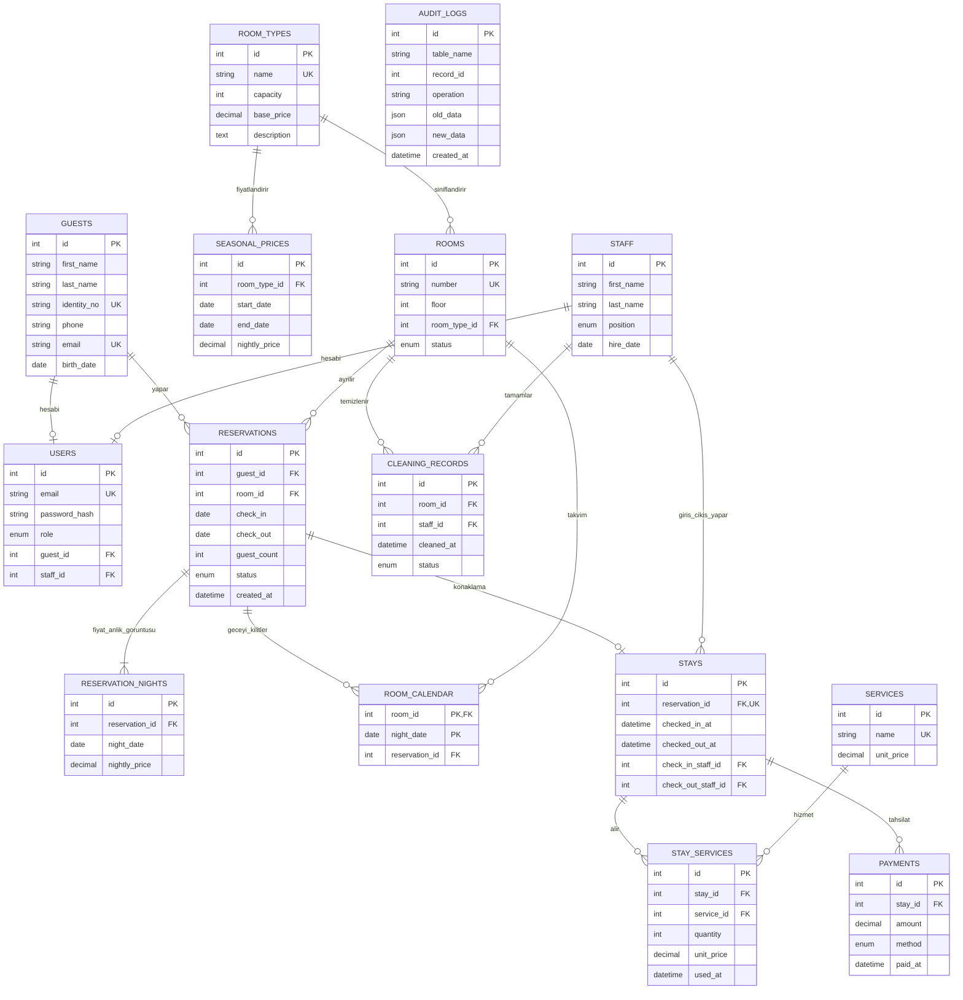

# ER diyagramı ve normalizasyon

Tablo adları kodda İngilizce, kullanıcı arayüzünde Türkçedir. GitHub bu Mermaid
diyagramını doğrudan görüntüler.

`audit_logs` silinen kayıtları da koruduğu için kaynak tablolara silinmeye bağlı
yabancı anahtar içermez; tablo adı ve kayıt numarası ile değişiklik geçmişini saklar.

## 3NF gerekçesi

1. **1NF:** Alanlar atomiktir; bir hücrede oda listesi veya hizmet listesi tutulmaz.
   Rezervasyonun geceleri ve konaklama hizmetleri ayrı satırlardır.
2. **2NF:** Kimlik tabanlı tablolardaki alanlar kayıt anahtarına bağlıdır. Oda takvimi
   bileşik `(room_id, night_date)` anahtarına sahiptir; rezervasyon bu oda/gece çiftini
   rezerve eden kaydı gösterir.
3. **3NF:** Oda tipi adı/kapasitesi `rooms` içinde tekrarlanmaz; personel adı
   `stays` içinde, hizmet adı `stay_services` içinde, misafir adı `reservations`
   içinde tekrarlanmaz. İlişkiler yabancı anahtarlarla kurulur.

`reservation_nights.nightly_price` rezervasyon yapıldığı andaki **sözleşilen gece
fiyatıdır**; güncel sezon listesinin kopyası anlamında kullanılmaz. Benzer biçimde
`stay_services.unit_price` hizmet verildiği andaki bedeldir. Sonradan fiyat listesi
değiştiğinde geçmiş hesapların değişmemesi için bunlar ayrı tarihsel olgulardır.
Hesap toplamları view/prosedür sorgularıyla üretilir; rezervasyona tekrar yazılmaz.

Oda durumu operasyonel bir durum bilgisidir. Check-in/check-out ve temizlik
tetikleyicileri bu durumu transaction içinde günceller. `room_calendar`, benzersiz
gece anahtarıyla yarış durumunu önleyen, tetikleyiciler tarafından yönetilen teknik
bir tablodur; uygulama bu tabloya doğrudan yazmaz.

## Ödevdeki adlarla eşleme

| Ödev tablosu | Uygulama tablosu |
| --- | --- |
| OdaTipi | room_types |
| Oda | rooms |
| SezonFiyati | seasonal_prices |
| Misafir | guests |
| Kullanici | users |
| Personel | staff |
| Rezervasyon | reservations |
| Konaklama | stays |
| EkHizmet | services |
| KonaklamaHizmeti | stay_services |
| Odeme | payments |
| TemizlikKaydi | cleaning_records |
| IslemLog | audit_logs |
